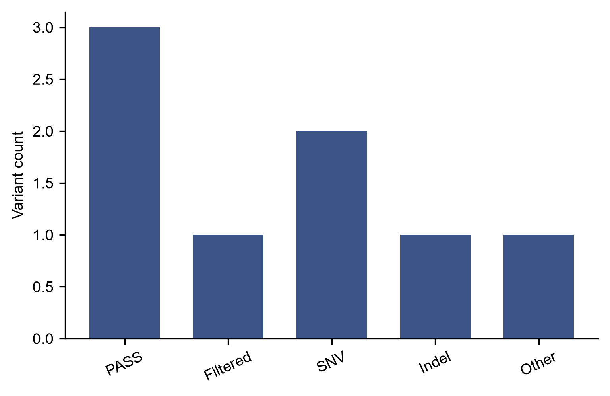

# 598 · ClairS 长读长体细胞变异输出审计

本模块读取 ClairS 兼容 VCF，生成透明的过滤状态与变异类型摘要。它不运行 ClairS 模型，也不以合成数据评估调用准确率。

## 1. 输入数据

`--input` 接受 VCF 4.2 文本，至少含 8 个标准字段；默认文件 `example_data/clairs_calls.vcf` 为合成演示数据。

## 2. 方法与原理

逐条解析非头部记录；`PASS`/`.` 计为通过，其余计为过滤。单碱基替换计为 SNV，等位基因长度改变计为 indel，其余计为 other。完整调用方法见 ClairS 论文与官方仓库：doi:10.1038/s41592-026-03152-4；https://github.com/HKU-BAL/ClairS 。

## 3. 用途

用于上游运行后的快速交付检查、样本级统计汇总和流程回归；真正的精度评估仍需独立真值集与规范化比较工具。

## 4. 特点与运行

默认零改动运行，不要求安装 ClairS。`--print-upstream-command` 只生成官方 README 已核实的命令，不执行。

```powershell
python 598_clairs_longread_somatic_audit.py
python 598_clairs_longread_somatic_audit.py --print-upstream-command --tumor-bam tumor.bam --normal-bam normal.bam --reference ref.fa --platform ont_r10_guppy --upstream-output output
```

依赖：Python、matplotlib。上游 ClairS 仓库许可为 BSD-3-Clause（以官方仓库当前 LICENSE 为准）。

## 5. 输出结果图

- `results/598_summary.csv`、`598_summary.json`
- `results/598_audit.png`、`598_audit.pdf`
- 展示图：
