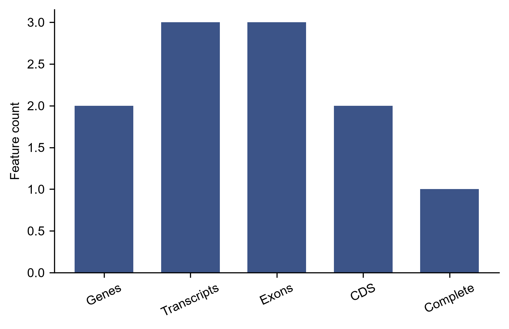

# 599 · EviAnn 基因组注释输出审计

本模块检查 EviAnn GFF3 的基因、转录本、外显子、CDS、证据和伪基因标记。它不重跑基因组注释。

## 1. 输入数据

`--input` 接受 9 列 GFF3；默认 `example_data/eviann_annotation.gff3` 是合成演示数据。

## 2. 方法与原理

解析 feature 列和键值属性，汇总层级元素、`Evidence=complete`、蛋白/转录证据及 `pseudo=true`。EviAnn 的方法和实际输出契约见 doi:10.1038/s41592-026-03156-0 与 https://github.com/alekseyzimin/EviAnn_release 。

## 3. 用途

适合注释任务结束后的结构完整性检查、版本比较和交付摘要；不能替代 BUSCO、参考注释对照或人工基因模型审查。

## 4. 特点与运行

```powershell
python 599_eviann_annotation_audit.py
python 599_eviann_annotation_audit.py --print-upstream-command --genome genome.fasta --reads-list paired.txt --proteins proteins.faa --threads 24
```

依赖：Python、matplotlib。上游可从 Bioconda 安装；官方仓库许可为 GPL-3.0。

## 5. 输出结果图

- `results/599_summary.csv`、`599_summary.json`
- `results/599_audit.png`、`599_audit.pdf`
- 展示图：
