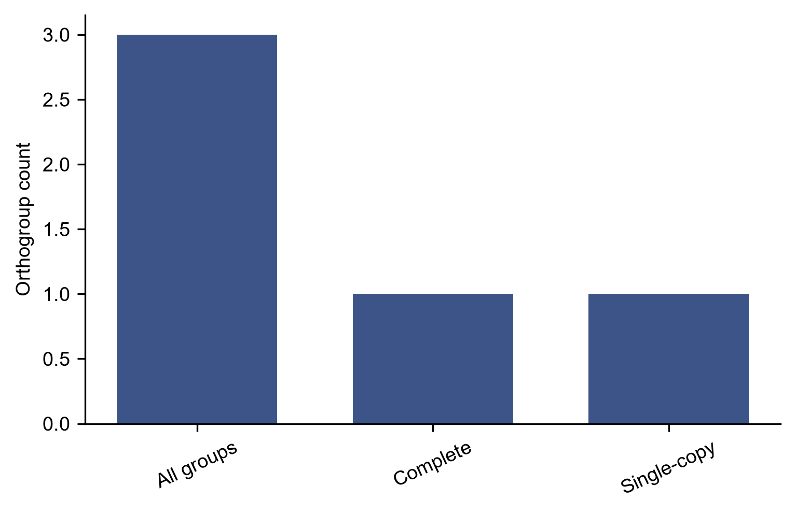

# 600 · OrthoFinder v3 直系同源组输出审计

本模块读取 OrthoFinder `Orthogroups.tsv`，报告物种覆盖、基因分配和完整单拷贝直系同源组。

## 1. 输入数据

制表符分隔表：首列必须为 `Orthogroup`，其余列为物种；单元格内多个基因以逗号分隔。默认样例为合成数据。

## 2. 方法与原理

逐组计算各物种基因数；所有物种至少一个基因定义为 complete，且每种恰好一个定义为 single-copy complete。本模块只解释标准表，不重写 OrthoFinder 的树和直系同源推断。官方代码与文档：https://github.com/OrthoFinder/OrthoFinder 与 https://orthofinder.github.io/OrthoFinder/ 。

## 3. 用途

用于比较基因组项目的结果验收、候选单拷贝组筛查和批次间覆盖比较。

## 4. 特点与运行

```powershell
python 600_orthofinder_v3_audit.py
python 600_orthofinder_v3_audit.py --print-upstream-command --proteomes proteomes --search-threads 8 --analysis-threads 4
```

依赖：Python、matplotlib。完整 OrthoFinder 建议独立 conda/Linux 环境；官方仓库许可为 GPL-3.0。

## 5. 输出结果图

- `results/600_summary.csv`、`600_summary.json`
- `results/600_audit.png`、`600_audit.pdf`
- 展示图：
