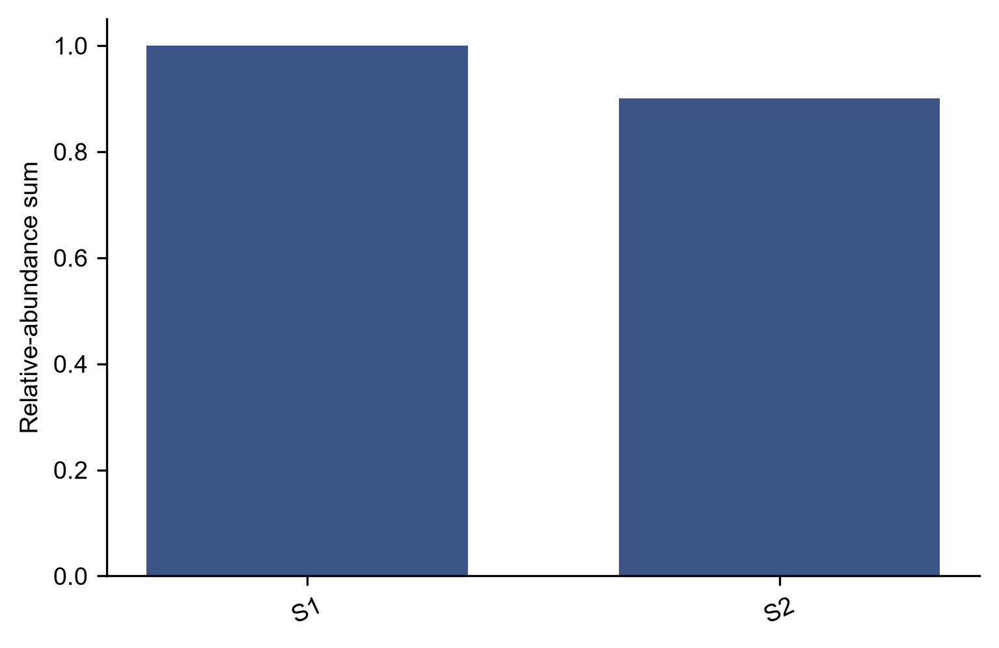

# 601 · CoverM 宏基因组丰度输出审计

本模块检查长表形式的 MAG/基因组相对丰度，报告样本、基因组、最大丰度及每样本归一化和。

## 1. 输入数据

CSV 必须含 `sample`、`genome`、`relative_abundance`；丰度必须为非负数。默认样例为合成数据。

## 2. 方法与原理

按样本求相对丰度和，并以绝对误差不超过 `1e-6` 判断是否恰为 1。CoverM 的映射和覆盖算法由上游程序完成；本模块只验收导出表。官方代码：https://github.com/wwood/CoverM ；方法论文 doi:10.1093/bioinformatics/btaf147。

## 3. 用途

用于宏基因组丰度矩阵进入下游差异分析前的格式、非负性和归一化检查。

## 4. 特点与运行

```powershell
python 601_coverm_abundance_audit.py
python 601_coverm_abundance_audit.py --print-upstream-command --bam sample.bam --genome-definition genome-definition.tsv
```

依赖：Python、pandas、matplotlib。完整 CoverM 建议 Bioconda/Linux；官方仓库许可为 GPL-3.0。

## 5. 输出结果图

- `results/601_summary.csv`、`601_summary.json`
- `results/601_audit.png`、`601_audit.pdf`
- 展示图：
