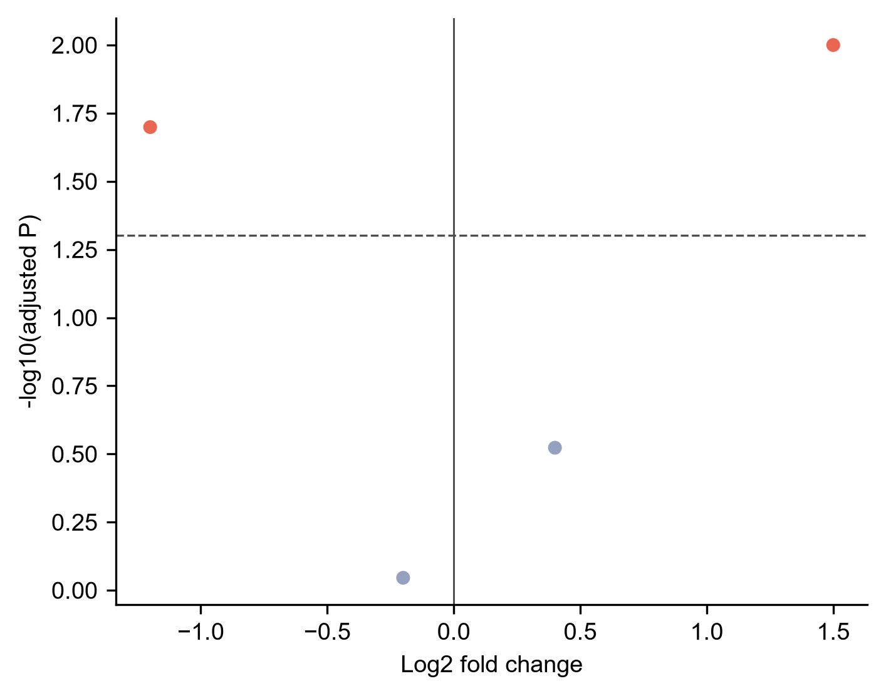

# 602 · damidBind 差异结合结果审计

本模块读取 damidBind `analysisTable()` 等路径导出的差异结合表，按 FDR 与效应方向生成摘要和火山图。

## 1. 输入数据

CSV 必须含 `locus`、`log2FoldChange`、`pvalue`、`padj`；默认样例为合成数据。

## 2. 方法与原理

以 `padj <= --fdr` 标记显著位点，再按 log2 fold change 正负区分 gain/loss。本模块不重新拟合 damidBind 模型。官方快速入门中的 `load_data_peaks()`、`differential_binding()` 与 `analysisTable()` 见 https://github.com/marshall-lab/damidBind ；论文 doi:10.1093/bioinformatics/btag512。

## 3. 用途

用于 DamID、CATaDa 或相关占据分析导出结果的交付检查、结果规模摘要和图形回归。

## 4. 特点与运行

```powershell
python 602_damidbind_result_audit.py
python 602_damidbind_result_audit.py --input exported.csv --fdr 0.05 --outdir results/run1
```

依赖：Python、pandas、numpy、matplotlib。完整统计分析使用上游 R/Bioconductor 包；官方仓库许可为 GPL-3.0。

## 5. 输出结果图

- `results/602_summary.csv`、`602_summary.json`
- `results/602_audit.png`、`602_audit.pdf`
- 展示图：
