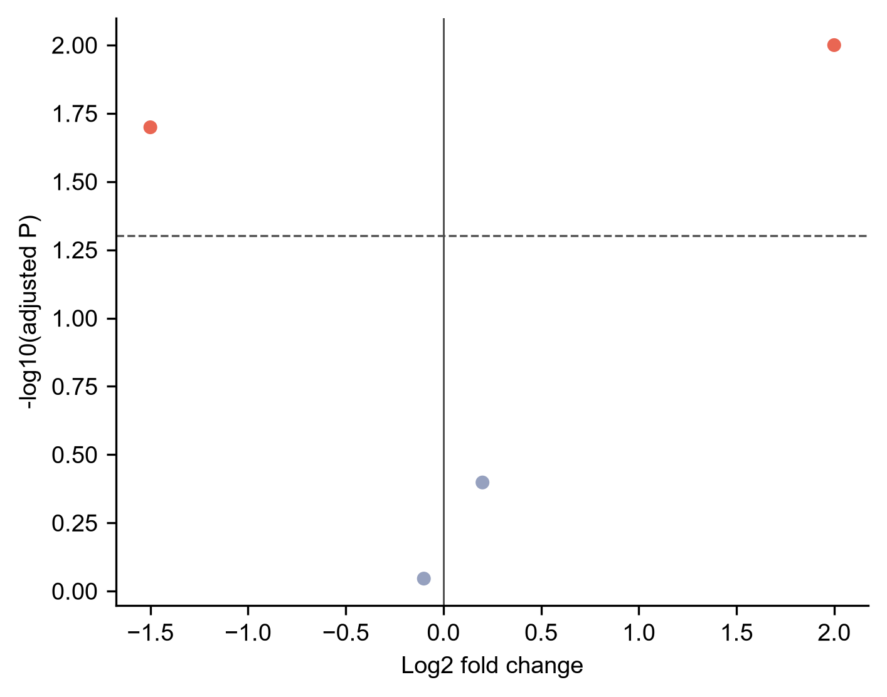

# 603 · DiaReport 差异蛋白结果审计

本模块读取 DiaReport/MSqRob 导出的差异蛋白表，按 FDR 与效应方向生成摘要和火山图。

## 1. 输入数据

CSV 必须含 `protein`、`log2FC`、`pvalue`、`padj`；默认样例为合成数据。

## 2. 方法与原理

以 `padj <= --fdr` 标记显著蛋白，再按 log2FC 正负区分上调/下调。本模块不重新实现 QFeatures、MSqRob2 或 Quarto 报告流程。官方入口与 `render_dia_report()` 契约见 https://github.com/Gevaert-Lab/diareport ；论文 doi:10.1093/bioinformatics/btag435。

## 3. 用途

用于 DIA 蛋白质组分析结果交付前的列契约、数值范围、显著结果规模和图形检查。

## 4. 特点与运行

```powershell
python 603_diareport_result_audit.py
python 603_diareport_result_audit.py --input exported.csv --fdr 0.05 --outdir results/run1
```

依赖：Python、pandas、numpy、matplotlib。完整 DiaReport 需 R、QFeatures、MSqRob2 与 Quarto；官方仓库许可为 MIT。

## 5. 输出结果图

- `results/603_summary.csv`、`603_summary.json`
- `results/603_audit.png`、`603_audit.pdf`
- 展示图：
